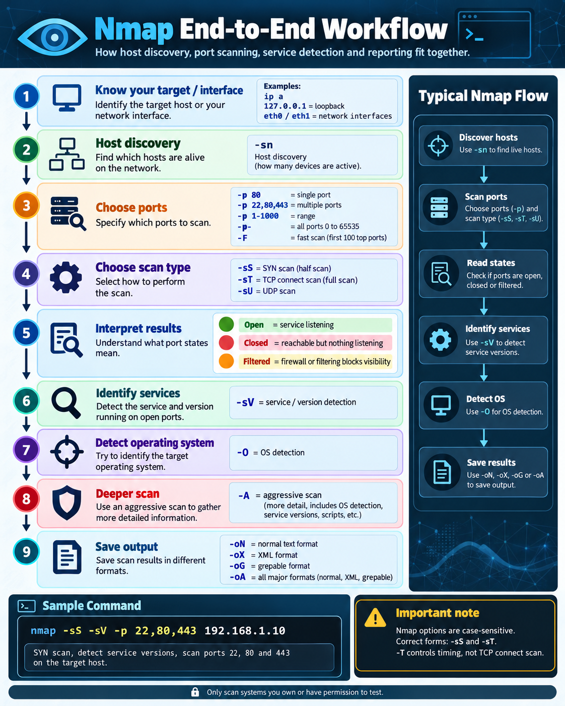
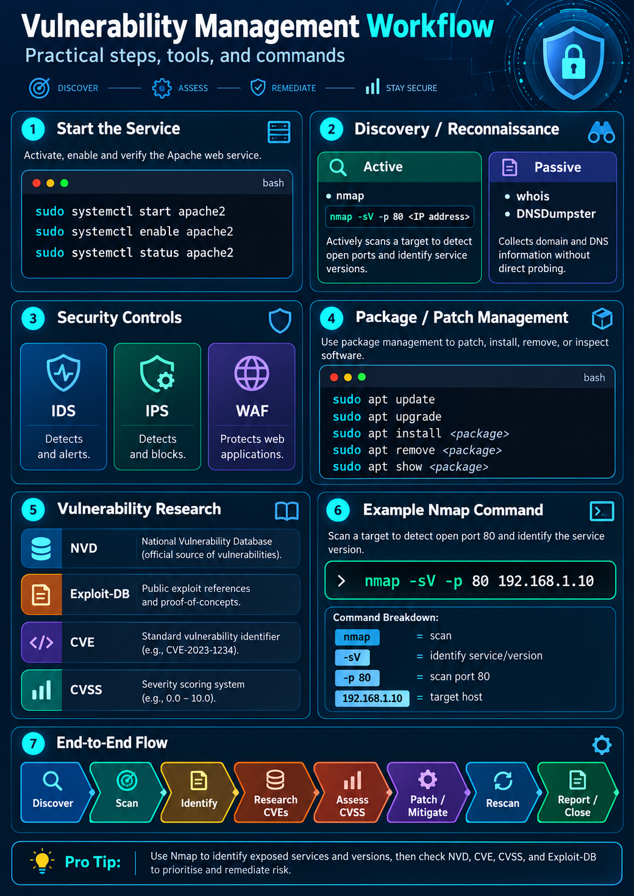
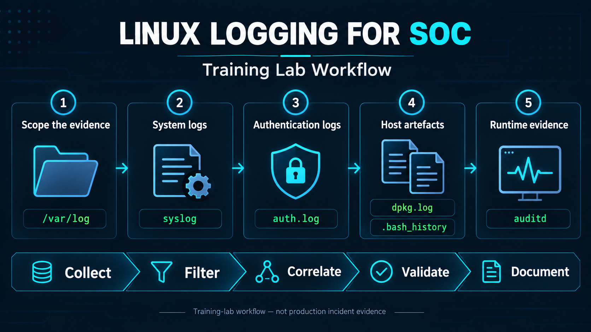

# Visual learning: cybersecurity workflows

**Tinu Adewumi | QASIC Cyber**

This collection brings together my cybersecurity study illustrations and practical learning notes. The workflows explain the purpose, steps and limitations of concepts explored during training. The graphics are study aids, not screenshots of completed assessments or proof that every depicted action was performed. Where material is a hypothetical example, it is labelled accordingly.

Use these techniques only in environments you own or are explicitly authorised to assess. Example addresses are illustrative. The related projects are fictional case studies; a project link indicates a connection in subject, not that every tool depicted here was used in that project.

## Explore the collection

| Learning area | What it covers | Related work |
| --- | --- | --- |
| [Nmap: from scope to recorded results](#1-nmap-from-scope-to-recorded-results) | Discovery, scan choices, port states and service identification | [Project 3](../Project%203/) |
| [Vulnerability management: discovery to validation](#2-vulnerability-management-discovery-to-validation) | Research, CVE, CVSS, risk assessment and controlled remediation | [Project 3](../Project%203/) |
| [Linux logging for SOC analysis](linux-logging-soc.md) | Training workflow using system logs, authentication events and other host evidence | [Project 1](../Project%201/), [Project 2](../Project%202/) |

## 1. Nmap: from scope to recorded results

**Learning focus:** Host discovery, port states, service identification and recording results.  
**Tools and concepts:** Kali Linux, Nmap, IP addressing, TCP/UDP ports and service-version detection.  
**Portfolio connection:** [Project 3: vulnerability governance and secure change](../Project%203/) considers how findings are assessed and prioritised for business risk. The project is a fictional case study; this is a separate study aid.

### How the workflow fits together

1. **Set the scope.** Identify the authorised lab target and network interface; record the purpose and limits of the exercise.
2. **Discover hosts.** Nmap's `-sn` performs host discovery without a port scan. A lack of response does not prove a host is absent.
3. **Select ports and scan type.** Choose relevant ports and a suitable TCP or UDP scan. Some methods require elevated privileges.
4. **Interpret the output.** Distinguish open, closed and filtered ports, considering how firewalls and network conditions affect visibility.
5. **Investigate and record.** Service-version detection (`-sV`) can provide clues; operating-system detection (`-O`) is an estimate. Save the output, record scope and time, and validate findings before treating them as vulnerabilities.

**Reading note:** The infographic describes `-p-` as including port 0. Nmap's `-p-` selects ports **1–65535**; port 0 requires explicit specification. Scan options are case-sensitive.

## 2. Vulnerability management: discovery to validation

**Learning focus:** Connecting technical discovery and vulnerability research to risk assessment and controlled remediation.  
**Tools and concepts:** Kali Linux, Nmap, Apache, systemctl, package management, CVE, CVSS, NVD and security controls.  
**Portfolio connection:** [Project 3: vulnerability governance and secure change](../Project%203/) applies risk prioritisation and decision-making to a fictional retail scenario.

### How the workflow fits together

1. **Identify the asset and service.** In a controlled lab, understand the service and whether its exposure is within the agreed scope.
2. **Discover and investigate.** Identify visible ports and possible service versions. Research advisories and CVE entries, checking whether they apply to the product and configuration.
3. **Assess the risk.** Consider CVSS alongside exposure, exploit information, asset criticality and existing controls. A score alone does not establish business priority.
4. **Plan a controlled response.** Select remediation or compensating controls and consider approval, testing, rollback and service impact.
5. **Validate and report.** Retest the relevant condition, record evidence and limitations, and communicate the result to an accountable owner.

**Reading note:** This is a simplified study workflow. Its tools are examples, not a claim that all were run or that a specific vulnerability was found or fixed. Changing services or packages can affect a system; use a suitable test environment and follow its change procedures.

## 3. Linux logging for SOC analysis

The Week 5 learning illustration brings together system logs, authentication records and other host artefacts in a repeatable SOC training workflow: **collect → filter → correlate → validate → document**.

[Read the full Linux logging workflow, example commands and evidence limitations](linux-logging-soc.md).

---

**About these visuals:** These study illustrations come from my Week 4 and Week 5 learning materials. They are learning aids, not proof of a live incident or actual result. More examples can be added after checking their source, accuracy and suitability for public sharing.

[Return to the main portfolio](../README.md)
