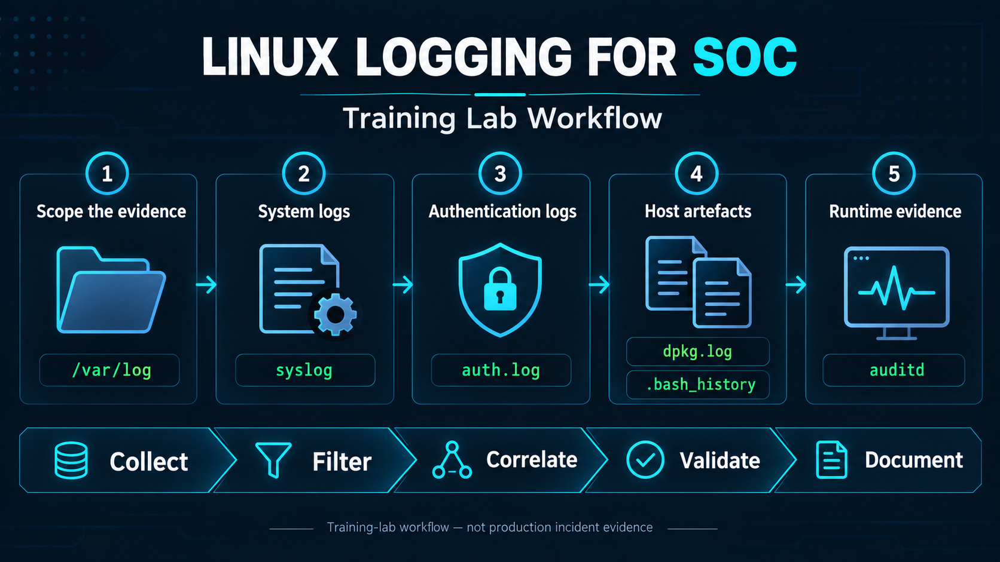
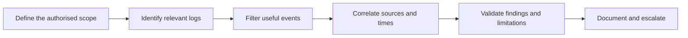

# Linux logging for SOC analysis

**Tinu Adewumi | QASIC Cyber | Training workflow**

## What this illustrates

The Week 5 *Linux Logging for SOC* training illustration shows how different Linux evidence sources can support a security investigation. Its sequence is **collect → filter → correlate → validate → document**. The illustration is a learning aid; it is not a record of a production incident or proof that each example command below was run.





## A practical workflow

| Stage | Purpose | Example learning action |
|---|---|---|
| Scope | Establish which test host, time window and question are in scope. | Record the lab name, system and time zone before examining events. |
| Identify sources | Select sources relevant to the investigation. | Review system logs, authentication records, package history and, where configured, audit events. |
| Filter | Reduce a larger log to entries worth examining. | Search for a known training term while preserving the original evidence. |
| Correlate | Place events from different sources in context. | Compare event times and related activity; account for time zones and missing logs. |
| Validate | Test alternative explanations. | Check whether activity was expected, repeated or corroborated; a single log entry is not proof of compromise. |
| Document | Support a clear decision and handover. | Record sources, commands, observations, limitations and the next action. |

## Illustrative Linux commands

These examples are for an authorised training system. Log paths and availability vary by distribution and configuration; access may require appropriate permissions. No output is claimed here.

```bash
# List available log files
ls -lh /var/log

# Review the most recent lines of a system log, if present
tail -n 30 /var/log/syslog

# Search authentication records for a training keyword, if present
grep -i 'failed' /var/log/auth.log

# Review recent package installation and change records, if present
tail -n 30 /var/log/dpkg.log
```

The study illustration also identifies shell history and `auditd` as possible sources. Shell history can be incomplete or altered; audit records are available only if auditing has been installed and configured. Treat each source as one piece of a broader evidence picture.

## Evidence and limitations

- **Source:** a Week 5 illustration titled *Linux Logging for SOC — Training Lab Workflow*.
- **Status:** a visual training summary, sourced from the Week 5 course folder.
- **Do not infer:** a real incident, a completed investigation, or a particular alert or command output from the graphic alone.
- **Portfolio connection:** [Project 1](../Project%201/) addresses control assurance and monitoring; [Project 2](../Project%202/) explores incident decisions and resilience through fictional cases. These links indicate relevance, not that this exact lab was performed in either project.

[Return to the visual learning collection](README.md)
