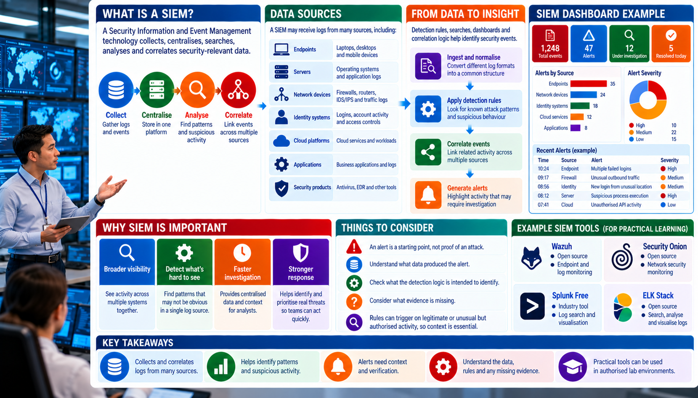
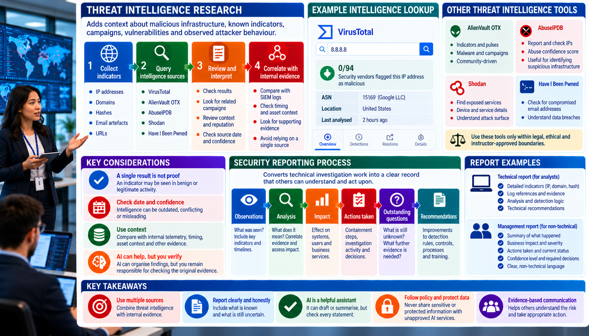

# SIEM, threat intelligence and security reporting

**Tinu Adewumi | QASIC Cyber | Cybersecurity learning**

These Week 1 study illustrations connect security monitoring to research, investigation and communication. They are learning aids: the dashboard values, alerts and lookup shown in the graphics are **illustrative examples**, not captured lab results or evidence of a production incident. Tool names in the illustrations do not mean that every tool was used in one exercise.

## 1. From events to an investigation

**Purpose:** Understand how a security information and event management (SIEM) platform can bring data together and support an analyst's investigation.

1. **Identify the question and sources.** A SIEM can receive events from endpoints, servers, network devices, identity systems, cloud services and applications, subject to what has actually been configured.
2. **Ingest and interpret.** Normalisation can make events from different sources easier to search. Time zones, incomplete collection and data quality can affect the picture.
3. **Search and correlate.** Searches and detection rules can highlight related events. Splunk is one tool explored in training; the image names other examples for context, not as a claim of hands-on use in a particular lab.
4. **Triage.** Establish what triggered an alert, which asset and user were involved, and whether activity was expected. A single alert is a starting point, not proof of an attack.
5. **Record and escalate.** Note observations, relevant evidence, uncertainty and the next decision; preserve appropriate context for the recipient.

The dashboard and its numbers in the illustration are a **fictional visual example**, not performance metrics or an actual incident record.

## 2. From threat intelligence to a useful report

**Purpose:** Understand how external context can help an investigation and how to communicate conclusions without overstating the evidence.

1. **Identify the indicator and question.** Establish whether the item is a domain, address, file hash or other indicator, and why it is relevant.
2. **Research responsibly.** Consult appropriate sources and note the date, attribution and any limits. The illustration names several services as examples; it does not document a specific search I performed.
3. **Assess confidence and context.** An indicator can be benign, outdated, shared or associated with many systems. Avoid treating one result as conclusive.
4. **Correlate with authorised evidence.** Compare research with relevant internal logs, asset ownership and activity within the agreed scope.
5. **Report for the audience.** Explain what is known, what is uncertain, possible impact, actions taken and recommended next steps. Adjust technical detail for analysts or decision-makers.

The lookup shown in the graphic is an **illustration**, not a verified research result. Review current source information before using any intelligence operationally.

## Portfolio connections

[Project 1](../Project%201/) explores control assurance and monitoring, while [Project 2](../Project%202/) uses a fictional incident decision scenario. These links show related themes; they do not imply that the graphics represent observations from either project.

[Return to the visual learning collection](README.md)
